<div align="center">
  
  <h1>ScreenBot Screensaver</h1>
  <p>A little robot, a lot of worlds. A playful screensaver for KDE Plasma 6 on Wayland.</p>
  <p>
    <a href="https://github.com/Chenboda01/Screensaver/releases/latest"></a>
    <a href="#platform-support-and-installation"></a>
    <a href="LICENSE"></a>
  </p>
</div>

---

ScreenBot follows Bob, a floating robot, as he explores themed worlds and fictional BobOS phone adventures. Customize the clock, weather, and optional Live Sky in KDE System Settings.

The **Customize Bob** section lets you choose Bob's display name, a cyan/green/purple/orange/pink/gold palette or any custom color, and an optional cap, bow tie, headphones, flower, crown, or antenna ball. Names support emoji and other languages and are capped at 16 visible characters. Your selected accessory stays in settings when weather gear appears; headwear that would overlap the Live Sky layer takes precedence.

The Python runtime is split into the `screenbot/` package: theme painters, weather effects, overlays, BobOS phone screens, settings, lifecycle code, and terminal agent detection are tested as separate modules. The top-level `screensaver.py` and `agent_prompt.py` remain compatibility and command-line entry points.

The Performance settings also include **Burn-in protection** for OLED displays, enabled in Standard mode by default. Standard mode slowly shifts the scene and drifts the clock within its selected area. Strong mode adds a gradual fade to black after 30 minutes, reaching black at 60 minutes; any keyboard or mouse input closes the screensaver and cancels the fade. Off retains the original fixed layout and brightness.

## Gallery

Bob exploring the Mountains under a full moon with Live Sky enabled (six-second loop):

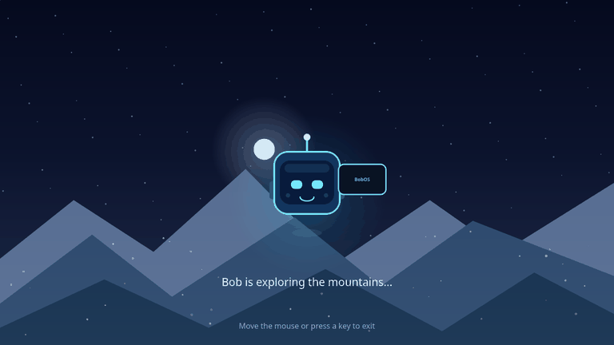

### Themes

| Space | Mountains |
| --- | --- |
|  | 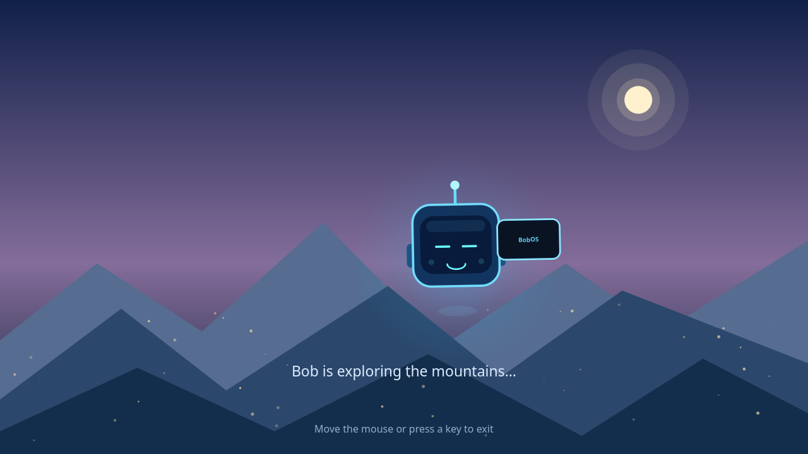 |
| **Snow** | **Forest** |
| 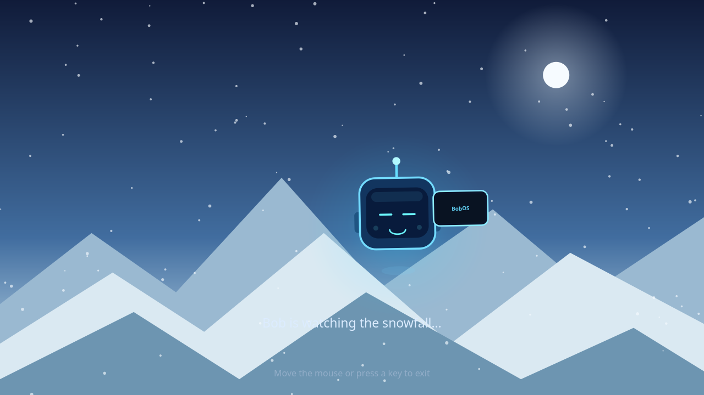 | 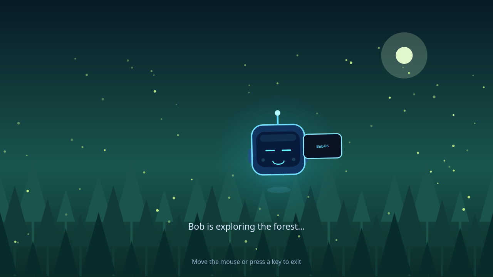 |
| **Futuristic City** | **Aurora** |
| 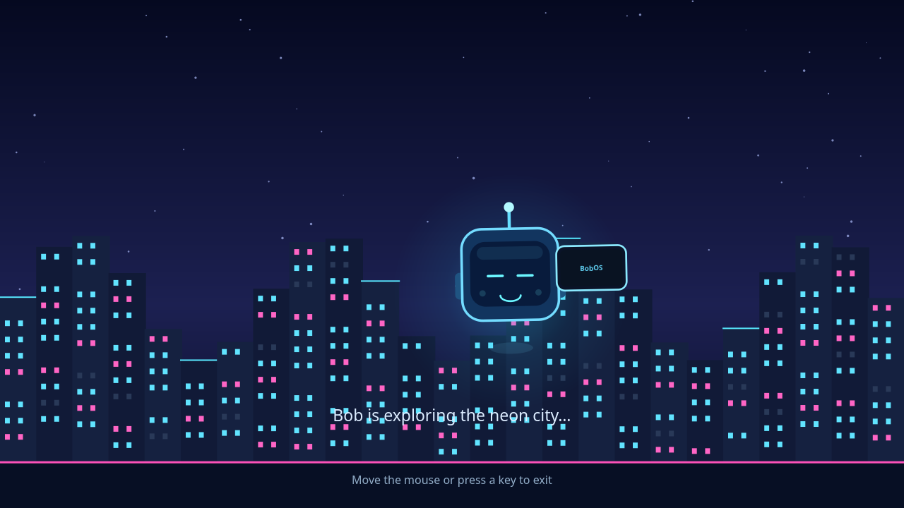 | 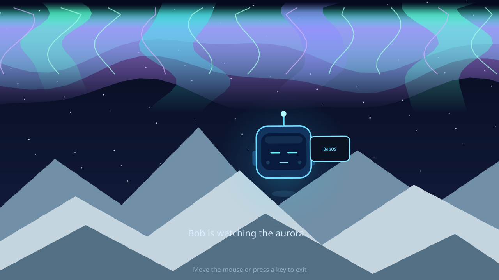 |
| **Ocean / Beach** | **Desert** |
| 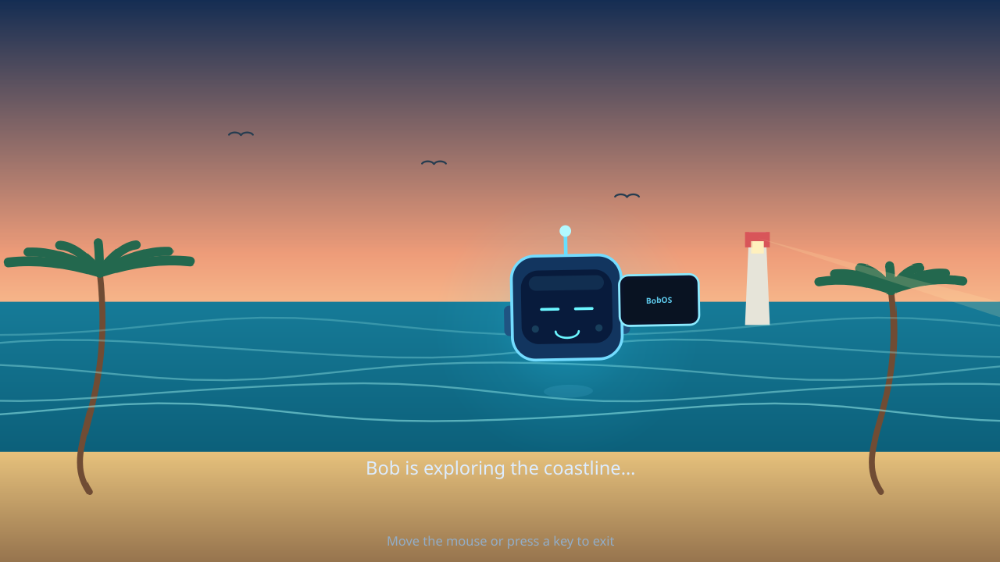 | 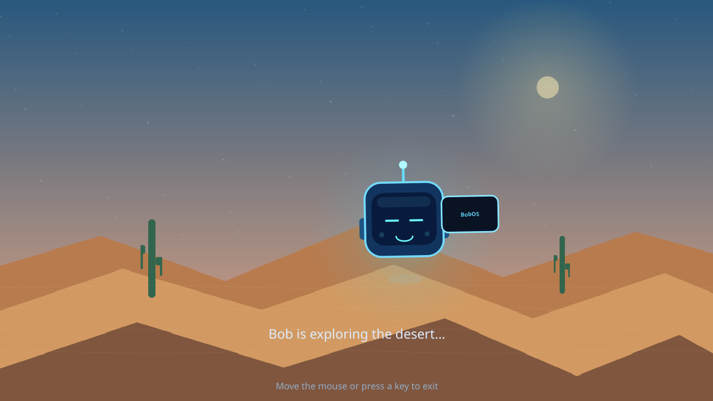 |
| **Underwater** | |
| 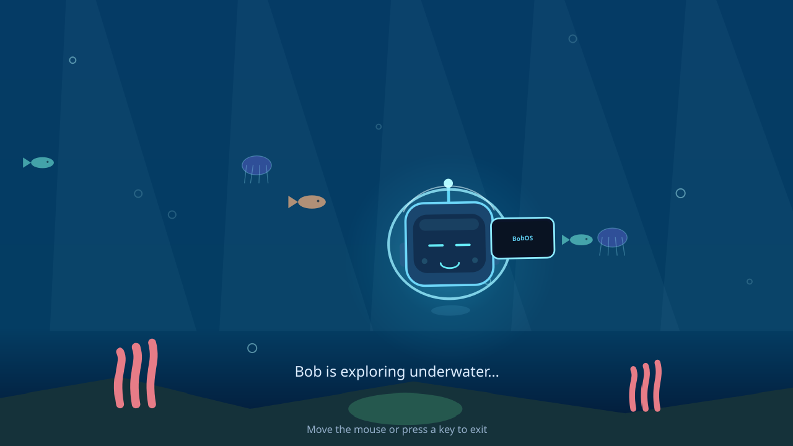 | |

### Live Sky

The same Mountains scene with locally calculated Boston skies and fixed example weather:

| Sunrise | Noon |
| --- | --- |
|  | 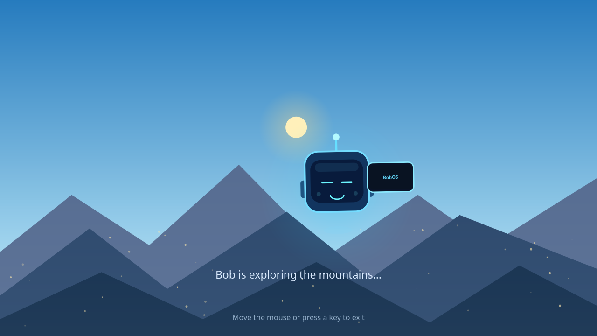 |
| **Sunset** | **Full-moon night** |
| 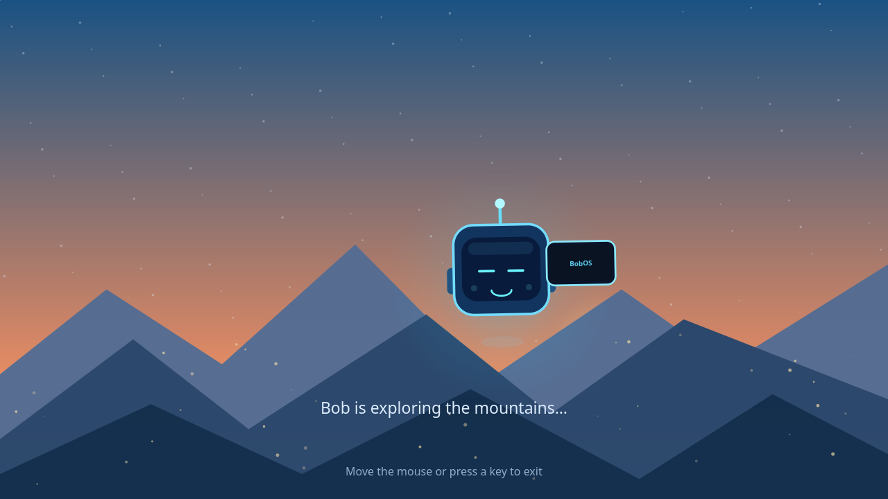 | 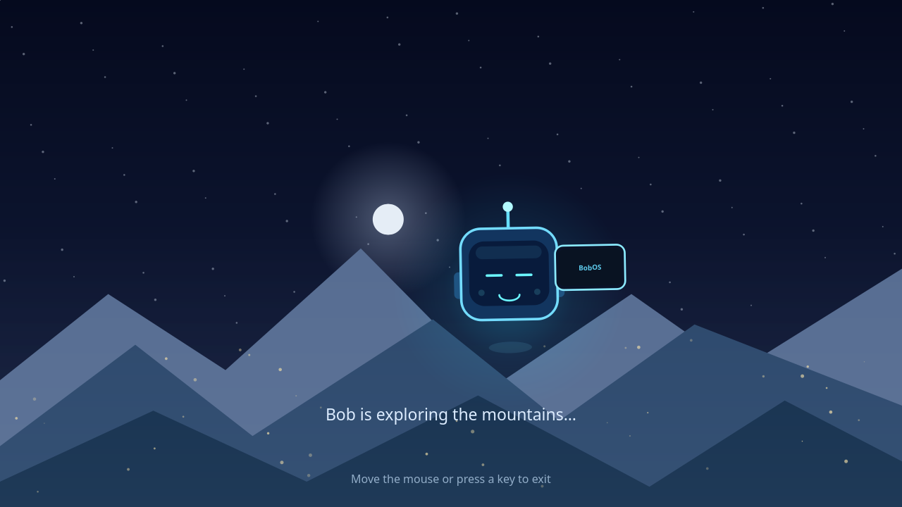 |
| **Rain** | |
| 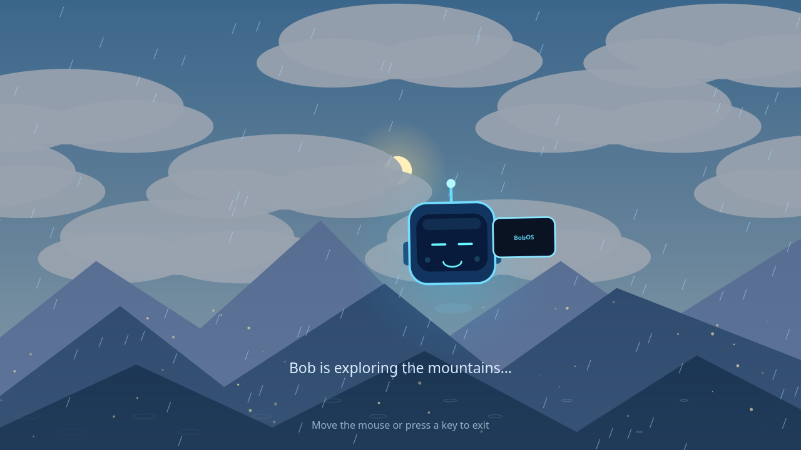 | |

### BobOS

Bob's fictional phone zooms into its home screen and opens Bob Browser:

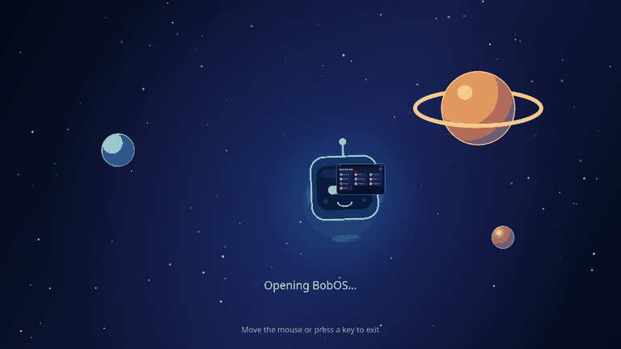

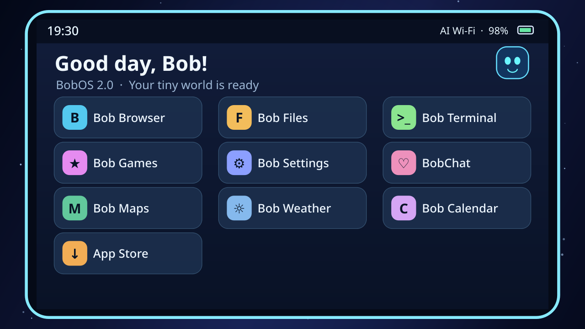

All previews are captured from the production renderer. Stills are 1280×720; animations are six-second, 768×432 loops. [Regenerate the gallery](assets/screenshots/README.md) after visual changes.

## Download

Get the latest ZIP from the [latest release](https://github.com/Chenboda01/Screensaver/releases/latest).
Browse [all releases](https://github.com/Chenboda01/Screensaver/releases) for older versions and release notes.
See the [changelog](CHANGELOG.md) for version history.

## Platform support and installation

The full screensaver and KDE System Settings module are supported on **Linux with KDE Plasma 6 and a Wayland session**. The installer builds a KDE settings component and uses Linux-specific Plasma, Wayland, and user-install paths.

### CachyOS and other Linux distributions with KDE Plasma 6 on Wayland

1. Confirm that KDE Plasma 6 is installed and you are using its Wayland session.
2. Install your distribution's packages for Python 3 with PyQt6, CMake 3.20 or newer, a C++17 compiler, Make, ECM 6+, Qt 6.5+ (Core, Quick, and QML), and KDE Frameworks 6+ (KCMUtils, CoreAddons, and I18n). Package names vary by distribution.
3. Download the ScreenBot ZIP asset from the [latest release](https://github.com/Chenboda01/Screensaver/releases/latest) and extract it, for example, into `~/Downloads`.
4. Open a terminal in the extracted folder containing `install.sh` and run:

   ```bash
   bash install.sh
   ```

5. When the installer offers idle start, choose whether to enable it and enter the delay (5 minutes by default). Then log out and back in so Plasma discovers the user-local settings module.
6. Open **System Settings → Screensaver**, select a theme and options, then choose **Apply**.
7. Check idle setup with `bash ~/ScreenBot/screensaver/start.sh --check`.

The installer builds the KDE Settings module and installs it to your user account without `sudo`. It copies the screensaver to `~/ScreenBot/screensaver`, keeps the three newest installation backups, and saves the KDE installed-file list in `~/ScreenBot/install_manifest.txt` for removal even if the build folder is deleted.

For unattended installation, use `bash install.sh --idle-minutes 5` to explicitly enable idle start, or `bash install.sh --no-idle` to leave Power Management unchanged. With no answer on standard input, idle setup is skipped. `bash install.sh --help` lists the options.

### Idle setup and removal

Automatic setup uses Plasma 6 PowerDevil's native Run Script idle action on AC power, battery, and low battery. It reloads PowerDevil after saving, preserves independent lock/suspend settings, and refuses to replace another idle script. Existing inhibitions and KDE's real screen locker still take priority. Close Power Management Settings before installation so an older unsaved page cannot overwrite the new configuration.

If you decline setup, PowerDevil is unavailable, or another script already owns an idle action, follow these steps:

1. Open **System Settings → Power Management → Energy Saving**. On newer Plasma 6 versions the power profiles appear directly under **Power Management**.
2. Select **On AC Power**. Under **Other Settings → Run command or script**, choose **Choose run conditions → When inactive**. Older Plasma 6 versions label this **Run Script → When idle**.
3. Use **Choose…** to select `~/ScreenBot/screensaver/start.sh` (expand `~` to your home directory when typing the path).
4. Set **Run after** to your preferred delay, such as **5 minutes**, and choose **Apply**.
5. Repeat for **On Battery** and **On Low Battery**, if shown. Run `bash ~/ScreenBot/screensaver/start.sh --check`; it reports each profile and returns nonzero if any profile is unconfigured.

To undo just ScreenBot's idle setup, run `bash ~/ScreenBot/screensaver/idle-trigger.sh --remove`, or clear its command in those profiles and Apply. The helper preserves another script if you replaced ScreenBot's command later. KDE Screen Locking remains independent.

### Uninstall and reinstall

```bash
bash ~/ScreenBot/screensaver/uninstall.sh
```

The uninstaller removes ScreenBot's application, installed KDE module and translations, city list, Plasma environment hook, and its idle action. It asks separately before deleting saved preferences (including section expansion state), Live Sky cache, and installation backups; the default is to keep each. It does not stop AI agents or other running applications. Log out and back in afterward so Plasma drops the Settings page and old environment hook.

For scripted removal while keeping personal data:

```bash
bash ~/ScreenBot/screensaver/uninstall.sh --yes --keep-settings
```

To explicitly remove personal data too, use `--yes --purge-settings --purge-cache --purge-backups`. `--keep-settings` always preserves preferences, even alongside `--purge-settings`. See `bash uninstall.sh --help` for details. The script also works from the extracted ZIP. To reinstall, extract a fresh ZIP outside `~/ScreenBot/screensaver` and run `bash install.sh` again; retained preferences are reused.

### Python interpreter

The installer selects `SCREENBOT_PYTHON` when provided, otherwise `python3` on `PATH`, then `python` if it is Python 3. It checks that PyQt6 is installed for that interpreter and saves its path in `~/ScreenBot/screensaver/python-path`. Automatic launches, manual launches, and KDE previews all use that saved interpreter. For a virtual environment with PyQt6, install with:

```bash
SCREENBOT_PYTHON="/path/to/venv/bin/python" bash install.sh
```

Keep that environment available after installation. If you move or remove it, rerun the installer with its new path. You can also set `SCREENBOT_PYTHON` for an individual launch. The launcher requires Bash and, for automatic launches, `flock` from util-linux on `PATH`.

### Windows and macOS

The full ScreenBot screensaver is not currently supported on Windows or macOS. There is no native installation guide for those systems: `install.sh` requires Linux, KDE Plasma 6, and Wayland, and the settings module integrates with KDE System Settings. Running the Python animation by itself would not install the screensaver or its KDE settings.

### Other operating systems

There are no tested or supported installers for BSD or other non-Linux systems. On another Linux distribution, use the steps above only if it provides KDE Plasma 6 on Wayland and the listed Qt/KDE development dependencies.

## Features

- Random, Space, Mountains, Snow, Forest, Futuristic City, Aurora, Ocean / Beach, Desert, and Underwater themes
- Configurable 12/24-hour clock, date, nine screen positions, font size, and visibility
- Individually enabled rain, snow, thunderstorms, and fog on landscape themes; Underwater turns rain, snow, and thunderstorms into surface ripples, optional shooting stars are limited to landscapes, and Space stays free of weather overlays
- Optional Live Sky with locally calculated sun/moon positions and phase, animated clouds, weather-aware sky and landscape effects, and a current-conditions display; it is off by default
- Optional head-local Bob weather reactions while Live Sky is on: a rain umbrella, snow hat and scarf, strong-sun sunglasses, fog squint, lightning surprise, wind response, moon glances, and a deep-night sleepy expression. Use `--preview-weather rain`, `snow`, or `clear-noon` with a quick preview to see the accessories without waiting for live conditions
- AI agent detection with a Remember my choice prompt, persistent automatic-launch policies, and a reset option in KDE Settings
- Optional primary-screen AI agent status badge with elapsed work time, confirmed finish time, and one short Bob celebration; uncertain states remain hidden and no prompts, filenames, or output appear on screen
- Manual launches remain available regardless of the automatic agent policy
- Bob's Phone and animated BobOS 2.0 with a fictional home screen, browser, files, terminal, games, settings, notifications, BobChat, Maps, Weather, Calendar, App Store, AI Wi-Fi, and an immediate preview
- Configurable BobOS delay of 1–30 minutes from the first visible screensaver frame, plus a cooldown of at least five minutes
- Animated head-only Bob; he stays still during his sleepy phase
- Optional KDE password-lock request with a 1–60 minute delay
- Optional countdown with a smooth green-to-red color transition

### Live Sky location and network privacy

Live Sky is off by default and makes no network requests while disabled. When enabled, choose a country and city from `countries_and_cities.txt` in KDE Settings. Only that selected place is sent to Open-Meteo to resolve coordinates and request current weather; the app does not send your public IP to a location provider. Weather observations and resolved coordinates are cached locally in `~/.cache/screenbot/live-sky.json`; weather is ignored after three hours. If weather is unavailable, the screensaver keeps rendering from its local sky calculations and the last resolved coordinates; on a first offline run with no cached coordinates it uses a neutral fallback sky. Solar and lunar positions are approximate visual calculations, not navigation-grade astronomy.

Bob's weather accessories are enabled by default and can be turned off in KDE Settings → Weather. The toggle only becomes available when Live Sky is enabled and a non-Space theme is selected. Force an accessory for a quick local preview with, for example, `bash ~/ScreenBot/screensaver/start.sh --preview --preview-weather snow`; the supported preview values are `rain`, `snow`, `thunderstorm`, `fog`, `clear-noon`, and `unknown`. Preview overrides do not request network data, and Space always suppresses weather accessories.

## Requirements

- KDE Plasma 6 on Wayland
- Python with PyQt6
- PyQt6 for the screensaver and agent-choice dialog
- CMake, a C++ compiler, Make, and the Qt/KDE development packages required by the KCM build

## Security

A Python screensaver is not a secure lock screen. KDE Screen Locking controls whether a password is required and may lock earlier for other reasons. Keep independent KDE locking enabled where appropriate.

## Translating the settings page

KDE settings follow the language selected in **System Settings → Region & Language**. Spanish is included; untranslated languages fall back to English. Restart System Settings after changing its language. Settings values remain language independent, and Apply/Discard work in every language. The screensaver's fictional dialogue and agent prompt are currently English only.

Install GNU gettext (`xgettext`, `msginit`, `msgmerge`, and `msgfmt`) to work on translations. From the repository root, regenerate the template with:

```bash
./kcm/Messages.sh
```

Create a catalog in `kcm/po/<language>/kcm_screenbot_screensaver.po` with `msginit --locale=<language> --input=kcm/po/kcm_screenbot_screensaver.pot --output-file=kcm/po/<language>/kcm_screenbot_screensaver.po` (create the language directory first). Translate the `msgstr` entries, preserving `%1`, `%2`, and plural forms. Update an existing catalog with `msgmerge --update kcm/po/<language>/kcm_screenbot_screensaver.po kcm/po/kcm_screenbot_screensaver.pot`. Check it with `msgfmt --check --statistics` before contributing the `.po` file.

The normal installer builds and installs catalogs through `ki18n_install(po)`; compiled `.mo` files belong in the installation, not in Git. QML uses the KCM plugin ID `kcm_screenbot_screensaver` as its translation domain; C++ uses the same domain through `TRANSLATION_DOMAIN`. The KCM leaves the hosting application's translation domain alone. To preview Spanish after installing, run `LANGUAGE=es kcmshell6 kcm_screenbot_screensaver` from a UTF-8 locale other than `C`.

For an isolated build, installation, locale, and Apply/Discard check, run `kcm/tests/check-translations.sh "$PWD/.omo/evidence/translations"`. It requires the `en_US.UTF-8` locale and records logs and native settings screenshots for Spanish, English, and an unavailable language's English fallback in both light and dark palettes. No user settings are changed.

### Now playing

Enable **System Settings → Screensaver → Clock → Show what's playing**, then choose **Apply** to show the current media title and artist near the clock on the primary screen. The setting is off by default; **Discard** keeps the saved preference. The card also works with the clock hidden. It moves to a clear corner if Bob would cover it, and stays hidden on small layouts with no room clear of Bob, the clock, and captions. Previews keep real media metadata hidden.

ScreenBot reads MPRIS metadata from players such as Elisa, VLC, Spotify, and browsers. Playing media takes priority when several players are open. Track changes appear within a few seconds; pausing or stopping fades the card away. Long titles are shortened, and no player or an unavailable session bus leaves the card hidden. Reduced motion hides the card without fading.

Song titles can be personal. ScreenBot never controls playback, reads browser tabs, fetches artwork or media URLs, or saves media metadata. Browser titles come only from the browser's MPRIS media information. Disable the setting and Apply before the next screensaver launch to stop showing it.
